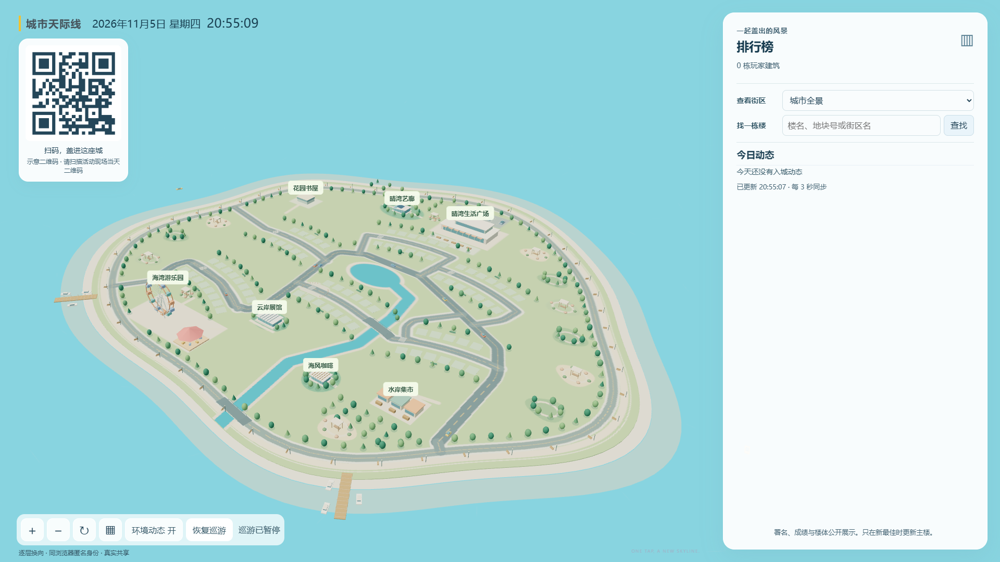
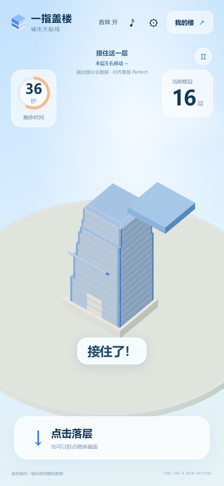
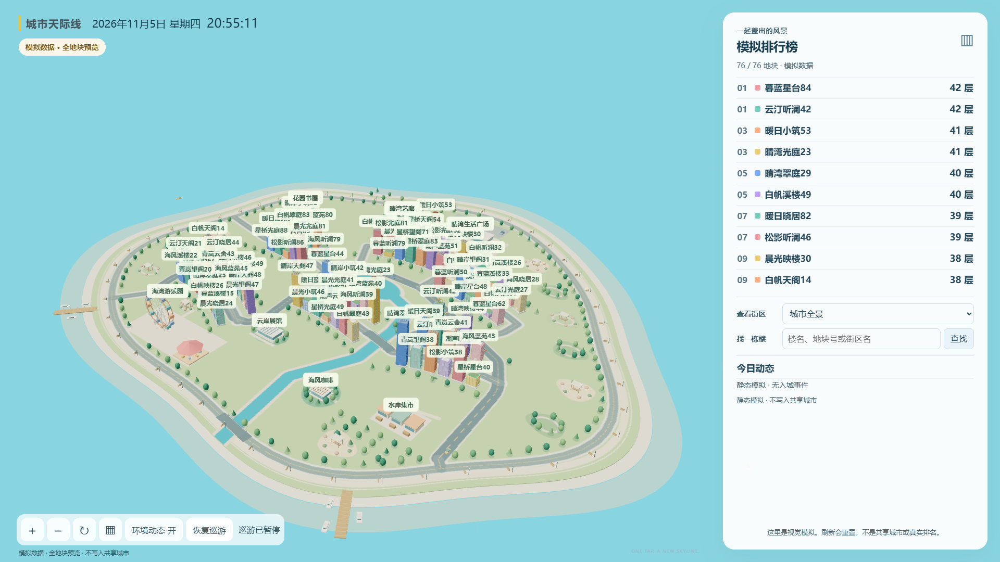

# One-Tap Skyline

[简体中文](README.md) · **English**

**One finger. One tower. A city built together.**

One-Tap Skyline is a QR-based game for live events, exhibition breaks and team gatherings. Catch moving floors on your phone, build your own tower and add it to a coastal city on the big screen. No app download or account registration is required.

## Start with an open city

Streets, parks, a fairground and waterfronts are ready for everyone’s towers. The display shows the day’s city and leaderboard, with an automatic camera tour, manual orbit and zoom, building-name search and district navigation.

*Illustrative initial scene with no player towers. The QR code shown is for illustration; scan the current code at your event to join.*

## Build with one finger

Floors alternate between sideways and front-to-back movement, using only one axis at a time. Tap to place a floor; overhanging parts are cut away. Accurate landings leave more room for the next floor. Ordinary landings, Perfects and misses have distinct visual and audio feedback.

  

*Phone-sized simulation of the running game. The floor count and remaining time come from this simulated round.*

1. **Scan the event QR code** to open today’s game.
2. **Tap to catch each floor.** Build for up to 60 seconds of active play; a miss ends the round early.
3. **Make the tower yours** with a name, a color and an optional photo.
4. **Find it on the big screen** using the leaderboard or building search.

## Every tower has its own character

- **Your floor count is your score.** Perfects and combos provide feedback without adding extra floors.
- **Keep building higher.** Your best result is retained for the day in the same browser. Lower or equal scores do not replace it. A displayed tower stays on its plot when a new personal best replaces it with the complete new tower.
- **Choose your look.** On your first result or a new personal best, change the name, choose from six colors and optionally add a photo. Photos can be previewed, replaced or withdrawn; uploading is optional.
- **Enjoy the skyline.** Towers have different decorations at different heights, and the top three leaderboard ranks receive special rooftop ornaments.

Names and saved photos are publicly displayed. Choose content you are happy to share with the event. Anonymous identity lasts for the day in the same browser; a different browser or device is treated as a separate participant.

## Fill the island together

Six districts provide 76 display plots. Every valid personal best is saved, while the highest-scoring 76 towers appear in the city. Earlier achievement takes priority when equal scores compete for a plot; leaderboard ranks may be tied. Towers outside the display remain available on the phone and can compete again with a better score.

***Simulated data: 76 sample towers fill the display plots. Names, scores and rankings are illustrative and do not represent real participants or event results.***

With moving cars and a slowly turning Ferris wheel, the display becomes both a leaderboard and a city scene created together.

## A fresh skyline every day

At 00:00 Beijing time, the city, scores, towers, photos and anonymous identities reset, and the participation QR code changes.

Keep the complete page opened from the QR code to refresh or play again that day. On the next day, scan the new event code and help build a new city.

## License

This project is licensed under the [MIT License](LICENSE).
