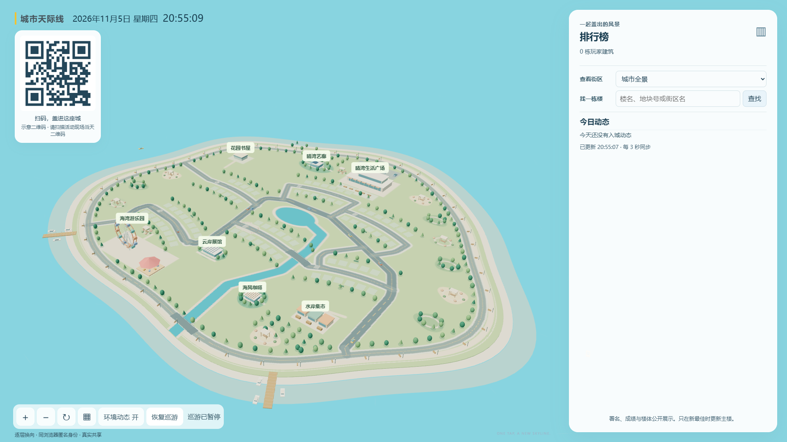
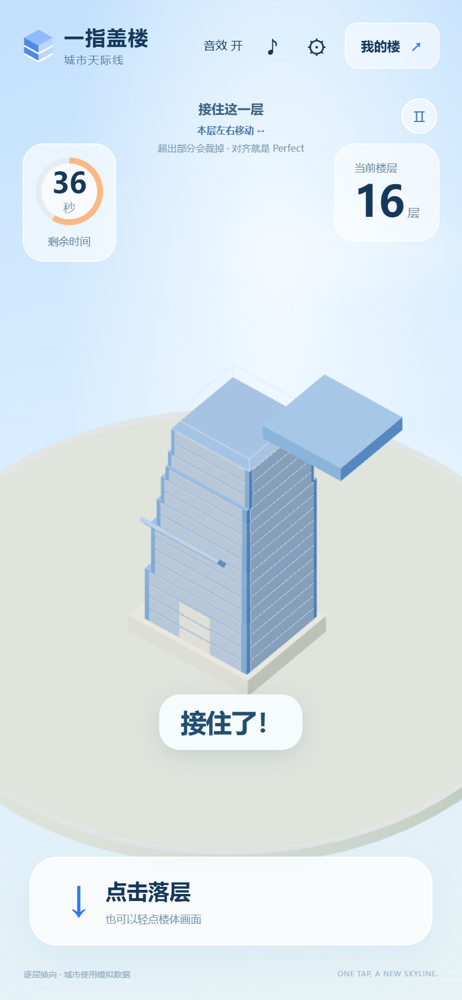
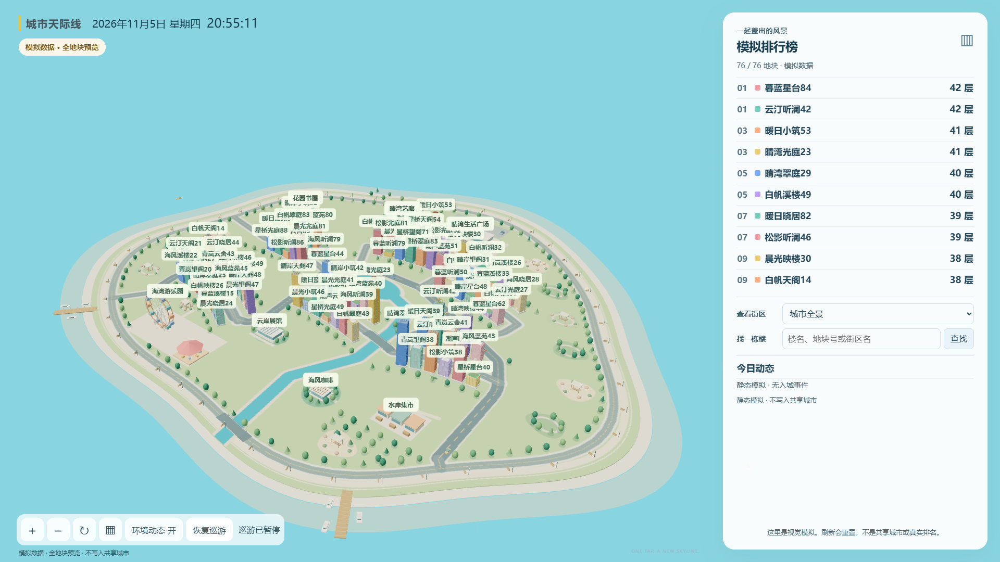

# 一指盖楼：城市天际线 · One-Tap Skyline

**简体中文** · [English](README.en.md) · [v1.0.0 发行说明](https://github.com/sw897/one-tap-skyline/releases/tag/v1.0.0)

**一根手指，一栋小楼，和现场的人一起盖出一座城市。**

《一指盖楼：城市天际线》（One-Tap Skyline）是一款开源盖楼游戏，适合年会互动、展会暖场和团队活动。玩家用手机扫码，在浏览器中一指堆叠楼层，用自己的最佳作品争取大屏上的 3D 滨海城市展示位，并参与共享排行榜。无需下载应用，也不用注册账号。

One-Tap Skyline is an open-source tower stacking browser game for live events, with QR-code participation, a shared 3D city display and a leaderboard.

**[在线模拟试玩](https://sw897.github.io/one-tap-skyline/)** · [手机盖楼](https://sw897.github.io/one-tap-skyline/?mode=practice) · [模拟大屏](https://sw897.github.io/one-tap-skyline/?mode=display&view=city&demo=full)

GitHub Pages 试玩无需登录，只有本页内存中的模拟数据，不联机、不接收照片。刷新或按设备时间换算的北京时间00:00重置本页；完整多人活动功能使用 Docker 部署。

*手机扫码或点击二维码即可模拟试玩；成绩只保留在本人当前页面，不会上传到共享大屏。*

[画面预览](#从一座空城开始) · [怎么玩](#手机上一指盖楼) · [自己部署](#在自己的活动中使用) · [反馈与部署服务](#反馈与部署服务) · [常见问题](#常见问题)

## 从一座空城开始

道路、公园、游乐场与水岸已经就位，城市等待大家一起点亮。大屏展示当天的城市与排行榜，自动巡游，也支持手动环绕、缩放、搜索楼名和定位街区。

*模拟初始场景，尚无玩家作品。图中二维码可打开[手机模拟试玩](https://sw897.github.io/one-tap-skyline/?mode=practice)，与上方二维码相同；完整活动参与码以现场大屏为准。*

## 手机上，一指盖楼

楼层左右、前后交替移动，每层只沿一个方向移动。轻点屏幕落下楼板，超出的部分会被裁去；越准，留下的空间越大。普通落层、Perfect与失误都有不同的音画反馈。

  

*手机尺寸模拟截图，展示实际运行中的模拟游玩；层数和剩余时间为该次模拟结果。*

1. **扫描现场二维码**，打开当天的游戏。
2. **点击接住楼层**，在最多60秒的有效游玩时间内挑战更高成绩；没接住，本局就结束。
3. **留下你的作品**，选择楼名、颜色，也可以自愿添加一张照片。
4. **去大屏找楼**，通过排行榜或楼名搜索，看看自己的作品有没有成为城市的一部分。

## 每栋楼，都有自己的样子

- **成绩就是层数**：Perfect和连击提供反馈，不额外增加楼层。
- **越玩越高**：同一天、同一浏览器保留个人最佳；低分或同分不覆盖原作品。已展示的楼刷新最佳时，在原地换成完整的新楼。
- **自由装饰**：首次成绩或刷新个人最佳时，可以改名、选择六种楼体颜色，并添加照片。照片可预览、替换和撤回，也可以直接跳过。
- **高低各有风景**：楼体随层数呈现不同装饰，排行榜前三名有特别的顶部装饰。

名字和保存的照片会公开展示，请选择愿意与现场分享的内容。匿名身份只在当天的同一浏览器中保留，不同设备或浏览器会视为不同参与者。

## 一起填满整座岛

城市共有六个街区、76个展示位。所有有效个人最佳都会保存，大屏展示层数最高的76栋楼；同层数竞争展示位时，先达到成绩者优先，排行榜允许并列。暂未入围的作品仍可在手机查看，也可以通过刷新最佳再次争取展示位。

***模拟数据：76栋样例作品填满展示位。图中楼名、成绩和排行榜均为模拟内容，不代表真实参与者或活动结果。***

车辆穿行、摩天轮缓缓转动，大屏既是排行榜，也是大家共同创造的一幅城市风景。

## 每天，重新出发

北京时间每天00:00，城市、成绩、作品、照片和匿名身份统一重置，参与二维码随之更新。

当天可以保留扫码打开的完整页面，刷新或再来一局；新一天，请扫描现场的新二维码，开始共建下一座城市。

上述城市与二维码重置规则适用于完整活动版。Pages 试玩地址固定，只重置本页状态，固定样例楼继续用于演示。

## 在自己的活动中使用

支持 **Docker 自托管**，可将手机扫码入口和城市大屏部署在自己的活动环境中。游戏使用 **TypeScript、Three.js（WebGL）、Node.js 和 SQLite**。搭建活动环境可查看[部署说明](docs/deployment.md)；想先在电脑上体验模拟玩法，可查看[本地运行说明](CONTRIBUTING.md#local-practice)。

## 反馈与部署服务

可提供**部署服务与活动前使用准备支持**，帮助将游戏准备好，供年会、展会或现场互动直接使用：参与者手机扫码盖楼，大屏展示城市与排行榜。具体服务范围和安排欢迎留言沟通。

- [问题反馈](https://github.com/sw897/one-tap-skyline/issues/new?template=bug_report.yml)：报告操作、画面、访问或部署问题。
- [需求建议](https://github.com/sw897/one-tap-skyline/issues/new?template=feature_request.yml)：描述希望改善的场景或新增功能。
- [部署服务咨询](https://github.com/sw897/one-tap-skyline/issues/new?template=deployment_support.yml)：说明计划使用时间、预计参与规模和希望获得的协助。

已有相关讨论时，可在[原有 Issue](https://github.com/sw897/one-tap-skyline/issues)下继续留言。留言需要登录 GitHub，内容公开；请先提供可公开的需求概况与脱敏信息，敏感部署资料通过后续约定的私密方式交接。更多说明见[使用与反馈指南](SUPPORT.md)。

## 常见问题

### 手机参与需要下载应用或注册吗？

不需要。扫描活动现场当天的二维码，即可在手机浏览器中游玩。同一浏览器当天保留自己的最佳作品。

### 超过76名玩家时，作品会丢失吗？

所有有效个人最佳都会保留；城市展示位由层数最高的76栋楼占据，同层数先达到者优先。暂未入围的玩家仍可在手机上查看自己的楼，并通过刷新最佳再次争取展示位。

### 为什么昨天的二维码不能使用？

游戏每天北京时间00:00重置全部游戏数据并更换参与二维码。新的一天需扫描大屏上的新二维码；当天已扫码打开的完整页面可以继续使用。

### 试玩填写的楼名会公开吗？

Pages 试玩不会上传楼名或成绩，只有本人当前页面能看到自己的模拟作品。完整共享版会公开展示保存的楼名与照片；当前只做长度和基础字符清理，没有内容审核。用于现场活动时，最简单的限制方式是只使用系统随机楼名；如需自定义，应先加入服务端内容校验和人工下架机制。照片也应单独考虑审核。

## 许可证

本项目采用 [MIT 许可证](LICENSE)。
