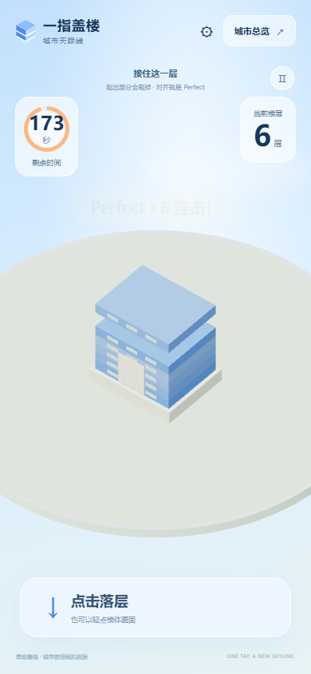
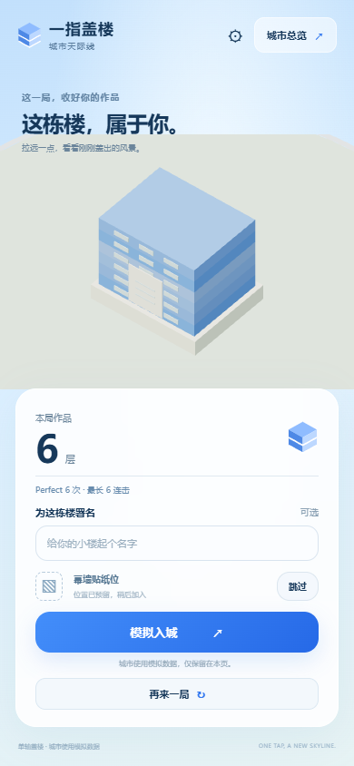
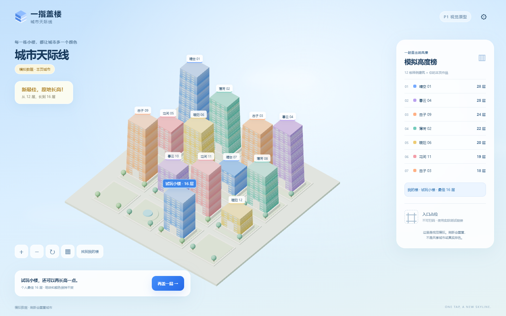

# P1 开发过程记录

截至 2026-10-12，Asia/Shanghai。游戏《一指盖楼：城市天际线》，公开默认城市名“城市天际线”。P1 可玩视觉原型和两次 Sites 发布已完成，iPhone 闪动修复获用户复测确认；安卓、完整真机流程和性能验收仍有缺项。P2 仅形成待审核计划，尚未实施。

[公开源码](https://github.com/sw897/one-tap-skyline)与当前模拟原型（线上地址私存）可访问。本记录是审阅后的培训摘要；原始提示词、选择、对话、客户交接资料、完整日志、截图和录屏继续在仓库外私存。

## 做了什么及为什么这样实现

P0 先检查实际工具链、Git、浏览器图形/输入、Sites 权限及后续 Docker 条件。初始目录只有交接资料，没有游戏源码或 Git。完整交接包移到源码目录之外并核对文件哈希，公开安全的 AGENTS 条款置于仓库根目录，建立 Git 基线。用户批准技术路线、要求补清配置/规则/真机安排后，才开始 P1。

P1 采用已锁定的 TypeScript、Vite、Three.js 静态前端，完成单轴移动、点击落层、交叠裁切、Perfect/连击提示、输入锁、计时/暂停和结束结算。基座计 0，成功落层计 1；连击只做反馈。结束后保留作品并展示完整楼体，再可选署名；幕墙贴纸只预留位置与跳过入口。

游玩、结算、城市都使用同一 TowerModel 和楼体生成器，统一层高 0.34、基座高度 0.42。三张概念图仅参考布局、配色和氛围，没有分别制作互不对应的三套楼。城市采用本页内存状态和 12 栋明确标为模拟的样例：首次入城分配固定地块；未破纪录保留完整原楼；新最佳用完整新局几何原地更新并长高，地块、颜色、署名稳定。没有拼接两局楼层，刷新页面会重置模拟。

启动时读取同源运行时 JSON，白名单校验后应用城市显示名和可调参数；异常时回退到中性默认。实际验证了本地服务器读取仓库外配置、过滤额外字段，未把活动覆盖文件写入公开源码或默认构建。静态 Sites 自动读取平台环境变量的能力未实现、未宣称通过。

## Commit 与部署对应

| 日期 | Commit | Tag | 实际用途和部署 |
| --- | --- | --- | --- |
| 2026-10-11 | `5a00a983d1d45e2babcd5cfeed1bbc38b93f5122` | 无 | P0 公开安全基线；Sites 当时仅预检，未发布游戏。 |
| 2026-10-11 | `381f32f4c423ff5cc9f8743abf022caaa2754e95` | `p1-core-visual` | P1 核心实现、验证后的源码；保存并部署 Sites 版本 1。 |
| 2026-10-11 | `79ea46896d9cef4ad4a5bc1123d97ead5530ca6c` | 无新 tag | 记录版本 1 发布和匿名访问结果，仅改文档。 |
| 2026-10-11 | `c73e4075dc5743ce828270661e2c4981c02170dd` | `p1-core-visual.1` | 首帧/切页渲染修订；保存并部署 Sites 版本 2。原 tag 保留。 |
| 2026-10-11 | `b17b4efd2f68f33963106360b8ad871bb1e25ce4` | 无新 tag | 记录版本 2 发布和 GitHub public 源码推送，仅改文档。 |
| 2026-10-12 | `fdb83b92ea60986acab45ee15674c7571712f053` | 无新 tag | 记录用户 iPhone 闪动复测确认，仅改文档；应用仍为版本 2。 |

版本 1 和 2 均从对应已推送源码的静态构建保存，原生部署结果为 succeeded。两版使用同一地址，**当前地址提供版本 2**；没有另造一个永久可浏览的版本 1 URL。历史版本由 Git tag、Sites 保存版本、静态构建包和私有实录追溯。每版都实际用两个全新未登录 Chrome 会话验证 200、触控开局、结算和模拟入城，并核对线上 JS/CSS 与对应本地构建 SHA256 相同。

用户明确批准任何知道链接的人免登录访问后才扩大原 owner 私有受众；另行授权在其账号新建公开 GitHub 仓库后，才审查并推送 main 与两枚 tag。后续文档推送也逐次审查实际范围、历史与 tag，原始证据未上传到仓库。

## 实际测试与结果

| 验证 | 实际操作及结果 | 证据编号 |
| --- | --- | --- |
| 核心规则与网格 | `npm test` 最终 10/10 通过：完全/左右部分/零交叠、Perfect 边界、无效输入、连点锁、暂停/结束、不同时间步长一致性；22→26 最佳更新、低于/等于最佳不变、重复/零层拒绝。12/26 层数据经三个生成场景核对网格与高度。 | P1 E02 |
| 类型检查与构建 | `npm run build` 执行严格类型检查和 Vite 生产构建，首版及渲染修订都通过；初次失败保留。 | P1 E03 |
| 运行中玩法 | `npm run test:browser` 首版最终 7 项通过，渲染修订后重新运行 7 项也通过、页面错误为空。可信鼠标输入实际玩出 12→9→16 层；首次入城、原楼不变、同地块长高连贯录屏，核对完整新最佳几何和高度 4.5→5.86 渲染单位。 | P1 E04 |
| 触摸与布局模拟 | Chrome 390×844 / 844×390 触摸模拟实际盖 6 层，验证暂停、旋转、结算、城市和刷新重置。它不是实际 iPhone/安卓测试。 | P1 E04 |
| 生产构建 | 首版和修订生产预览均 200，可信触摸实际盖 1 层，无页面错误；开发 QA 状态接口在生产构建中不存在。 | P1 E05 |
| 运行时配置 | 仓库外 JSON 的本地服务器响应 200，额外字段被过滤，默认仍中性，配置未复制入源码；浏览器测试另验证覆盖与不可用时回退。 | P1 E06 |
| LAN 兼容性 | 电脑 Chrome 通过实际 LAN HTTP 访问，非安全上下文中 randomUUID 不可用而 getRandomValues 可用，临时局次键 fallback 后能开局。用户手机仍无法访问该 LAN 地址，不能由电脑 200 推断真机可达。 | P1 E07 |
| Sites 发布与匿名 | 版本 1、2 原生保存/部署成功，各两个新建无登录会话实际通过；零初始 cookie、不用账号或访问绕过 token。版本 1 的两个真实失败尝试与后续成功分别保留。 | P1 E08 |
| 首帧/切页修订 | `node regression.mjs` 实测旧版有 19 种切页中间画布尺寸，修订后 1 种；3 次城市首帧/切页、结算动画、旋转共 5 项检查通过，无页面错误，并有实录。 | P1 E09 |
| 真实 iPhone 反馈 | 用户先反馈 Chrome、Safari、微信内置浏览器免登录及触控正常，但初始化/切页闪动；版本 2 后用户于 2026-10-12 确认闪动已修复。未给机型/系统或各浏览器分别复测记录。 | P1 E10 |
| GitHub public | 新仓库创建成功；每次源码/文档 public 推送前审查，实际推送和无认证 refs 读取成功，main 与两枚 tag 对应正确。 | P1 E11 |

浏览器自动化为稳定比较使用过 180 秒、速度 3.2、Perfect 12%、落层 0.12 秒等测试配置。公开默认为 60 秒、速度 2.7、每层增速 0.035、Perfect 3.5%、落层 0.24 秒；**自动化成功不证明默认参数好玩**。修订后重新运行的是受渲染改动影响的浏览器/生产检查；核心规则源码未变，10 项核心测试沿用先前结果，未冒充再次执行。部分测试先于提交，在私有台账中注明候选工作区与最终修复提交的关联。

## 关键问题与修改原因

| 实际问题或反馈 | 处理及验证 | 关联 |
| --- | --- | --- |
| Windows 工具链安装脚本找错 npm 模块；Node strip-types 不接受渲染类参数属性；首轮 TypeScript 检查失败。 | 使用本机 npm 安装；改普通字段赋值，修正启动视图类型与缺失模型维度。修订后测试/构建通过。 | `381f32f`，P1 E01/E02/E03 |
| 首次浏览器录像因 FFmpeg 缺失而失败。 | 安装 Playwright FFmpeg，之后实际连续录像成功；保留原失败输出。 | `381f32f`，P1 E01/E04 |
| 两次运行完成 12 层却等不到可见结算；最高楼屋顶被裁、手机结算遮挡楼体。 | 结算/城市容器补尺寸，调整城市镜头范围、手机楼体保留区域和短屏滚动；最终运行和截图复核通过。 | `381f32f`，P1 E04 |
| 电脑非安全 LAN HTTP 缺 randomUUID；用户手机不能访问 LAN。 | 增加临时局次键兼容路径，电脑 LAN 开局验证；手机改用真实发布的 Sites 地址。未断言网络失败原因、未修改防火墙。 | `381f32f`，P1 E07/E10 |
| Windows tar 将盘符理解为远程主机，首次部署包打包失败。 | 使用官方 helper、force-local 和绝对路径格式后打包成功。只打包构建产物/清单，无原始证据和交接包。 | `381f32f`，P1 E01/E08 |
| Sites 初始文档请求 403，另一次浏览器外 JSON 请求收到 403/HTML。 | 核实受众为 public；真实页面内请求及新建未登录会话通过，未使用绕过 token。根因未最终确定，保留两次失败，不能写成从未发生。 | `381f32f`，P1 E08 |
| 用户 iPhone 报告初始化和切页闪动。 | 发现画布布局持续变化且首帧镜头未匹配新视图；取消布局尺寸动画、真实 resize 后同步绘制、初始/城市镜头立即匹配，保留结算动画。19→1 尺寸测量、回归及版本 2 真机反馈构成验证链。 | `c73e407` / `p1-core-visual.1`，P1 E09/E10 |
| 私有证据汇总早于异步服务器清理完成，读取尚未写出的文件失败。 | 等待实际清理完成后重新汇总，应用代码未受影响；保留这次归档失败。 | P1 E01/E12 |

人作出的关键选择是先批准技术方案、保持统一楼体/中性配置/模拟边界、允许明确范围的公开体验，并在真实 iPhone 上指出和复核视觉问题。代码修订和版本发布逐条对应这些决定，没有把模拟排名或工具链成功包装成正式运营能力。

## 尚未验证或未记录

- 安卓 Chrome 真实访问、触控、旋转和结算没有结果；两机三种入城情景的完整真机验收没有实录或完整反馈。已有运行中 Chrome 自动化实录。
- 手机具体型号、系统/浏览器版本、刷新率、网络条件未补全；iPhone 修订后各浏览器分别复测及真实手机截图/录屏缺失。
- 默认配置下的实际局时长分布、成功率、Perfect 分布、误触率、重玩意愿和多参与者结构化试玩未记录。不能称已完成手感调优。
- 一般/低端手机 FPS、输入延迟、持续游玩发热和长时稳定性未量化；不同时间步长的逻辑测试不等于真机帧率验收。
- 403 的具体根因与不同网络下长期访问可靠性未最终验证。真实共享排名/跨设备身份/持久化、上传、完整大屏和 Docker/SSH 尚未实现，按 P3–P6 处理。
- 未形成全部历史聊天和所有工具调用的一份完整导出。保存的是关键需求/选择原文、日志、修订、实录和关联台账；原策划会话部分回复返回内容引用，不能把不可读正文当作新证据。
- 首个功能提交前的多次修复最终汇总进 `381f32f`，没有每个中间故障各自的源码 commit。现有日志/截图可证明失败，但不能声称能从该 tag 单独还原每个失败源码状态。

## 经审阅的程序截图

以下均来自 `c73e407` 的运行中 Chrome 自动化，含模拟城市和测试编号，无客户素材、真实照片或账号信息。前两张是 390×844 触摸模拟，不是真实手机截屏；测试配置上限为 180 秒，因此游戏图显示 173 秒，不代表公开默认已改为 180 秒。原始媒体仍私存。

游戏中实际盖出 6 层：

同一局完整作品结算与贴纸跳过入口：

桌面自动化同页三局 12→9→16，当前显示新最佳在原地长高后的模拟城市：

## 证据位置与后续方式

P1 E01–E12 是私有证据的固定分组：E01 需求/工具链/实际失败，E02 核心测试，E03 构建，E04 玩法及三情景截图/实录，E05 生产烟雾测试，E06 配置，E07 LAN，E08 Sites 保存/部署/匿名，E09 闪动修订，E10 真实手机反馈，E11 public 推送审查/结果，E12 台账与哈希。绝对文件路径及对应 commit/tag 在仓库外的培训证据映射表中，整理后文本另同步到用户指定的策划会话。

仅上述三张审阅后的中性程序截图作为公开案例材料；完整原始媒体未整包上传。本地路径只能定位文件，不代表远端会话已收到附件。截图和实录来自运行程序，与三张“设计示意”概念图分开。后续每阶段及重要修复按[统一记录模板](development-record-template.md)续记；P2 的[实施计划](P2-implementation-plan.md)待审核，记录整理不构成开工批准。
