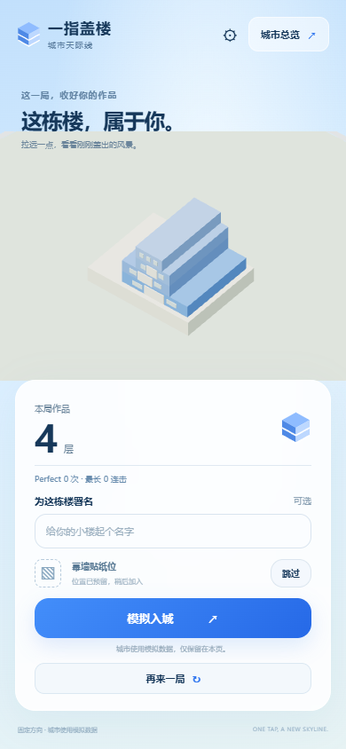
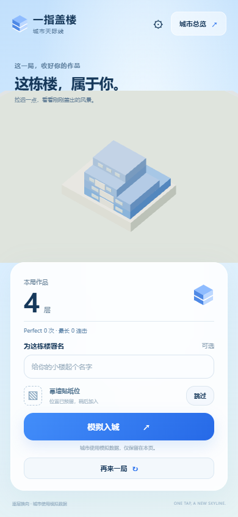

# P2 交替裁切对比候选开发记录

2026-10-12，Asia/Shanghai。**状态：B 方案对比候选已部署 Sites 版本 3，收到首轮 iPhone 偏好与操作反馈。** 本条记录交付对比候选，P2 最终验收和大众手感尚未定型。

## 反馈与实现

用户反馈固定方向裁切使楼体单调，希望增加堆叠趣味与成品美观，同时保留一指操作；随后批准 [B 方案](P2-implementation-plan.md)，选择先由本人用 iPhone 对比。大众易上手、60 秒基线、连击仅反馈已确定；安卓暂不安排。

每层扩展为位置 `x/z` 与尺寸 `width/depth`。默认逐层交替 X/Z，仍是每层单轴、点击落层；非活动方向继承上一层，活动方向求交，Perfect 对齐但不补宽、不加层。X/Z 入场距离与速度按基础边长同比例换算；每种方向的入场侧轮流。固定 X 候选保留原移动范围与速度。

三端继续共用楼体模型与生成器。移动块、窗口、幕墙预留、断料、标签和镜头都适配逐层进深；幕墙预留改为逐层贴面，避免跨退台漂浮。断料采用当前层颜色，沿真实裁切方向掉落/旋转，真实切口短暂亮边；暂停时切口与断料冻结。原横屏样式隐藏所有说明文字，方向提示因而会被隐藏，已调整并经旋转检查；没有先录到独立失败测试，不补造失败截图或修复前 SHA。

两种候选使用同一构建、画面与默认参数，只用经过白名单校验的 `cut` 链接参数选择方向；页面显示当前方向与候选。仍使用本页模拟城市，不引入身份、真实排名、上传、云存储或后续阶段功能。

## 版本对应

起点为 `c73e4075dc5743ce828270661e2c4981c02170dd` / `p1-core-visual.1` / Sites 版本 2。审定计划版本为 `d335b56e5842e5f276c9a1c23e391d509a487c51`。候选应用为 **`db2921b2a5adea660db93371483a764956e556df` / `p2-cutting-preview` / Sites 版本 3**；原 P1 tag 和部署记录保持不变。

版本 3 源提交经 Sites 保存回执核对，公开部署返回 `succeeded` 与实际链接。两种入口使用同一版本：逐层换向 B（线上地址私存）、固定方向基线（线上地址私存）。公开源码与候选 tag 经无认证远端引用核对。后续记录文档提交不改变上述应用或部署。

候选用 `p2-cutting-preview` 标记；`p2-playtest` 留待真实试玩与最终候选确认，不能据自动化通过提前宣称 P2 验收完成。

Sites 源同步助手第一次在打包环节失败：Windows 默认 `bash` 指向 WSL，而本机 WSL 的 `/bin/bash` 不存在。源推送在该步骤之前已完成；仅重试官方打包器，将任务进程的 `bash` 指向 Git for Windows，并适配归档驱动器路径，随后版本保存与部署成功。完整失败和恢复日志私存，没有改插件源码、扩大受众或覆盖 Git 历史。

## 实际测试与结果

| 检查 | 实际结果和范围 |
| --- | --- |
| 核心规则 | `node --experimental-strip-types --test tests/core.test.ts tests/cutting.test.ts`：22/22 通过。覆盖双侧 X/Z 裁切、面积守恒、Perfect、漏放、非法尺寸、暂停/连点、方向切换、归一化周期、固定 X 基线、三端矩阵与幕墙位置、跨候选的新最佳完整替换。 |
| 类型与构建 | `tsc --noEmit`、Vite 生产构建通过；最终构建 14 模块。CSS 方向提示调整后重新构建，发布文件哈希私存。初次核心/类型命令完整 stdout 未重定向，保存工具结果摘要；后续构建与浏览器日志另存。收尾核对未找到旧索引声称的独立类型检查日志，以当时摘要为依据，完整类型日志缺失。 |
| 浏览器流程 | `node tests/browser.mjs`：7 组通过，错误为空；真实程序输入验证 12→9→16、署名/颜色/地块稳定、完整几何替换、旋转、暂停、刷新重置及配置回退。此回放使用 180 秒、12% 容差等稳定配置，不能当作真人难度结论。 |
| 方向对比 | `node tests/cutting-browser.mjs`：2 组通过，错误为空。两种方向都用未覆盖的 60 秒/2.7 初速/3.5% 容差默认配置，真实触控自动化各裁切 4 层。校验断料颜色/面积、效果暂停、横屏提示、结算与首次入城同模型。实际结束时长约 5.78 秒和 5.53 秒，输入时序并非严格相同，不能由这两个时长推断难度改善。 |
| 首帧与镜头 | `node tests/visual-browser.mjs`：5 组通过，错误为空；三次入城视口均只有 1 种尺寸状态，镜头就绪、结算拉远保留、旋转画布稳定重绘。 |
| 本地生产 | 2 组通过，错误为空；两种候选 HTTP 200，生产包不暴露开发 QA、默认 60 秒，实际触控完成 1 层、结算、跳过幕墙与首次入城；JS/CSS 与构建哈希一致。线上另行验证，不用本地结果代替。 |
| 线上免登录 | 首次导航超时，日志保留，原因未确证。按实际试玩链接重试后 2 组通过、错误为空：全新未登录上下文中两种入口均 HTTP 200，实际触控完成 1 层、结算、跳过幕墙与首次入城；线上 JS/CSS 与本地构建 SHA256 一致。没有使用登录绕过令牌。 |

以上浏览器结果来自桌面 Chrome 的手机尺寸与触控模拟，**不是实际 iPhone 或安卓验收**。下图是两种候选各 4 层、默认参数下的实际自动化结算截图，经过审阅；裁切落点并非逐帧完全相同。

## 未验证与证据

用户实际反馈：**iPhone 13 Pro，Chrome、Safari、微信内嵌浏览器；更喜欢逐层换向 B，没有触控或闪动问题。** 此结论来自用户文字反馈，未取得真机截图/录屏；系统和浏览器版本、确切局数/配置/成绩、各浏览器详细步骤未提供。不能据此认定方向理解、重玩意愿或所有真机流程都已验收。

完整真机三种入城、持续游玩、量化帧率/触控延迟、发热及浏览器差异仍未验证。安卓按用户决定暂不安排，继续列为缺口。

用户询问大屏城市总览的进度：P1/P2 已有同一模拟城市的桌面布局，可用 城市总览直达入口（线上地址私存），或首页右上角“城市总览”与结算“模拟入城”进入。独立的大屏展示流程、街区轮播和完整互动仍在 P5，不把当前模拟总览说成已经实现 P5。直接打开新页面仍会重置本页模拟状态。

已实际验证上述公开直达链接：全新未登录桌面 Chrome、1920×1080、HTTP 200，显示“城市天际线”、12 栋样例、可见三维画布及模拟标记，页面错误为空；截图和报告私存。当前手机与电脑的页面数据尚未共享，跨设备共享城市成绩在 P3。

证据编号 **P2-B1**：原始批准、实现决定、22 项核心摘要、构建日志、7/2/5 组浏览器报告、截图/录屏、生产/线上检查、公开历史与标签审查、Sites 回执和同步正文/读回回执均在仓库外私存；本机培训索引提供实际路径、哈希与 commit/tag 对应。公开只纳入两张经审阅的中性截图与此摘要，原始反馈/日志/录屏不直接入库。同期整理问题和留证缺项也保留。

后续按 [统一记录模板](development-record-template.md)追加真实反馈、改动理由、版本与测试，不覆盖旧结果；向授权策划会话同步后读回核对。P3–P6 保持原阶段边界。本次 [P2 收尾核对](P2-closeout.md)汇总已交付内容、原测试与验收缺项，未重跑游戏测试；[P3 实施计划](P3-implementation-plan.md)待审核，尚未实施。
